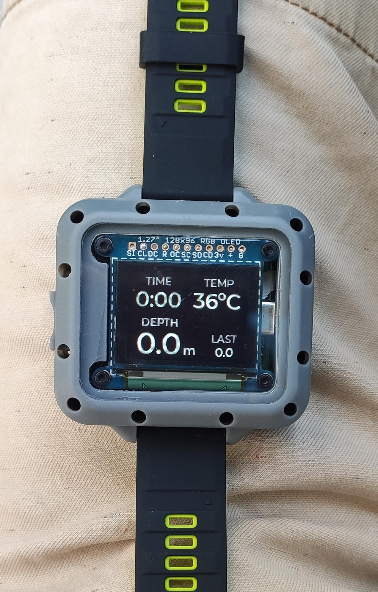
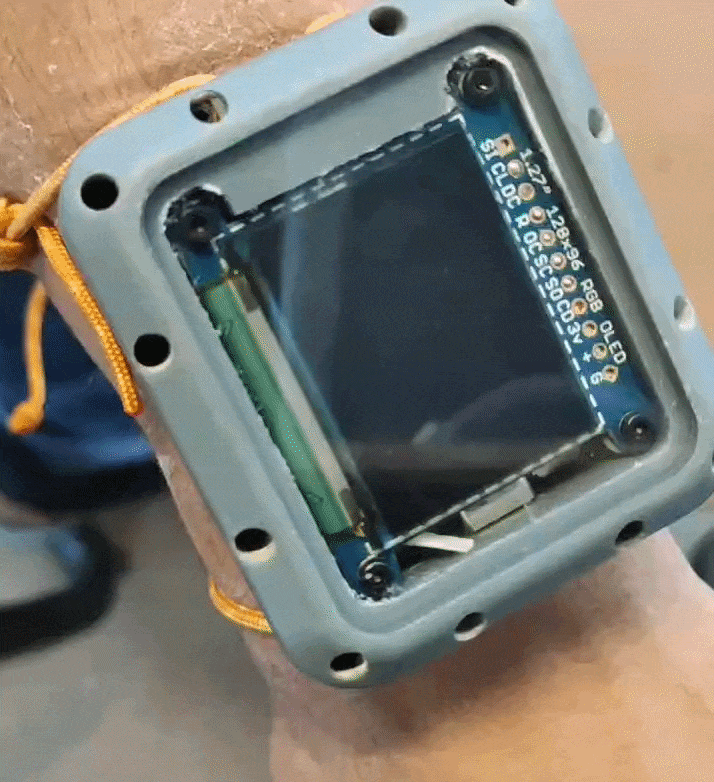
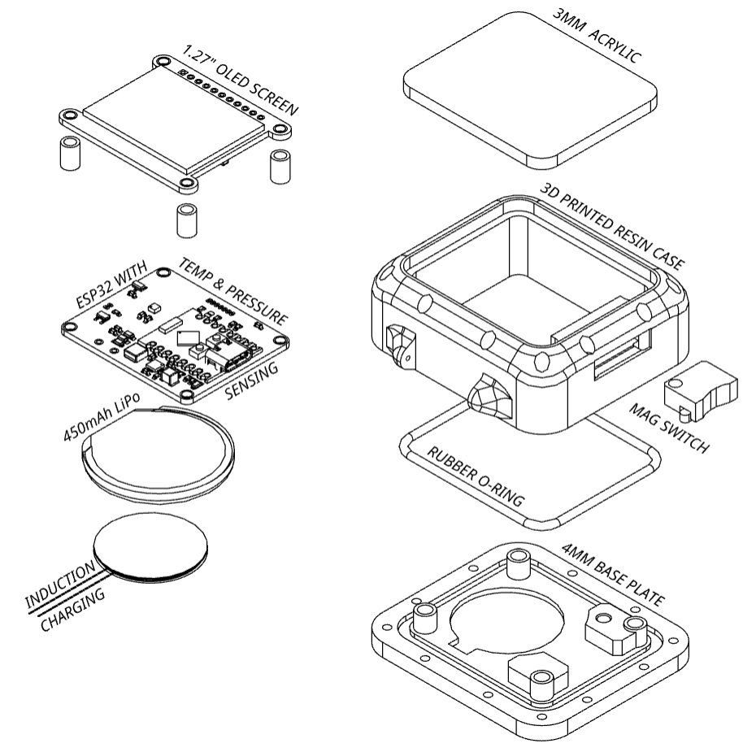
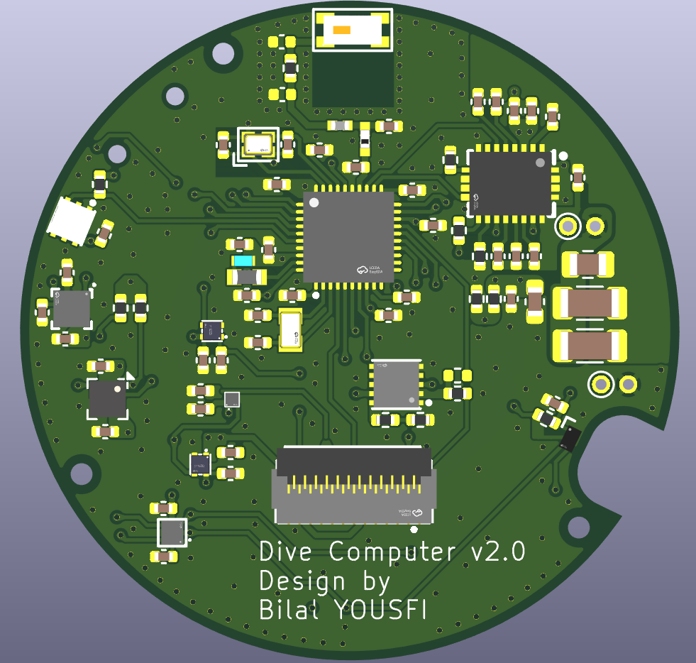
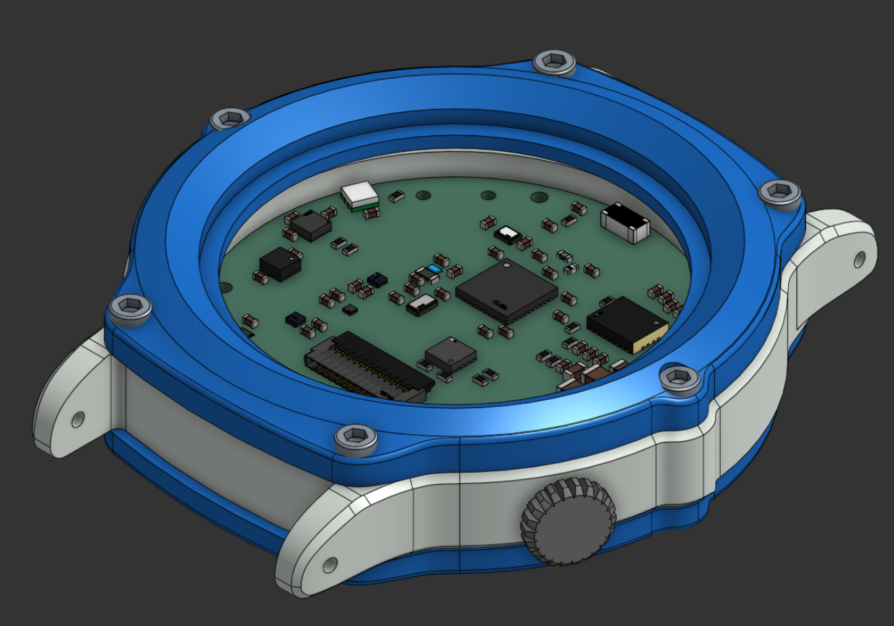
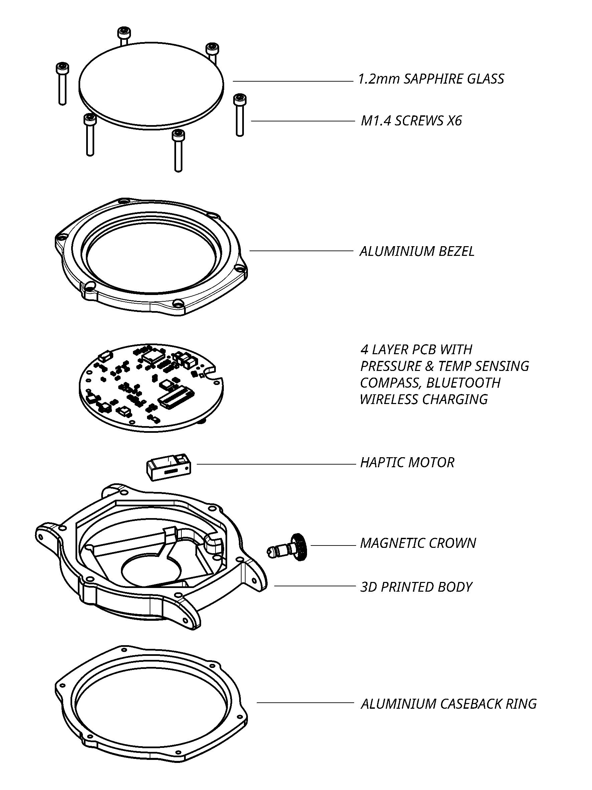

# Freediving Computer

A wrist-mounted freediving computer with tap navigation, wireless charging, and a fully sealed enclosure — no buttons, no external connectors.

<p align="center">
  
</p>

---

## V1 — Proof of Concept

Proved two core ideas: **tap-based navigation** via accelerometer and **wireless charging** inside a completely sealed case.

| | |
|---|---|
| **MCU** | ESP32-C3 |
| **Display** | 1.27″ SSD1351 color OLED (128×96) |
| **Pressure** | MS5837-30BA — ±2 mm resolution |
| **Navigation** | LIS2DUX12 tap detection — no buttons |
| **Charging** | LTC4120 wireless receiver — no connectors |
| **Switch** | Magnetic battery cutoff — true 0 µA storage |

### Interface

<p align="center">
  
</p>

<p align="center"><em>Tap-based menu navigation — accelerometer detects directional impacts on the casing.</em></p>

### In the Water

<p align="center">
  
</p>

<p align="center"><em>Live depth tracking — automatic dive detection and surface recovery timer.</em></p>

### Enclosure

<p align="center">
  
</p>

Two-part sandwich assembly sealed by a perimeter O-ring and 12 M2 screws. No dynamic seals anywhere.

---

## V2 — Work in Progress

More compact, better component integration, and additional sensors.

### PCB

<p align="center">
  
</p>

### 3D Model

<p align="center">
  
</p>


### Exploded View

<p align="center">
  
</p>

---

## Android Companion

The offline Android app, Linux BLE watch simulator, and protocol tests live in [`app/`](app/README.md). Development is on a dedicated branch; V1 and V2 firmware remain independent.

## Repository Structure

```
Dive_Computer/
├── V1/         # Prototype — full firmware + hardware source files
├── V2/         # Current revision — in progress
└── app/        # Android companion, BLE simulator and protocol tests
```

See [`V1/README.md`](V1/README.md) for detailed hardware architecture, firmware design, and dive state machine documentation.
